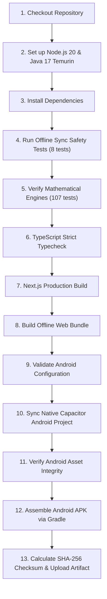

# MathSphere AI — Android APK Build and Installation Guide

This guide provides step-by-step instructions for building, downloading, and installing the **MathSphere AI** Android APK (`com.arulagnes.mathsphereai`).

You **do NOT need** Android Studio, Android SDK, or local Gradle installed on your computer. All compilation and packaging are handled automatically by **GitHub Actions** cloud runners.

---

## 1. Selecting Your Build Mode

MathSphere AI supports two distinct build configurations in the GitHub Actions workflow:

| Build Mode | When to Use | Requirements | Features Included |
| :--- | :--- | :--- | :--- |
| **`offline`** *(Recommended / Default)* | Independent student or laboratory use without continuous internet. | None. Zero secrets or server URLs required. | Complete local matrix calculator, REF/RREF, SVD 14-step derivations, QR, PCA, eigenvalues, and number theory running 100% on-device. |
| **`online`** | Connecting the Android APK to your deployed MathSphere AI web platform. | Repository Variable: `CAPACITOR_SERVER_URL` (e.g. `https://mathsphere.vercel.app`). | Full online platform: user authentication, My MathBook notebook, 100+ problem question bank, visualization lab, and cryptography lab with IndexedDB offline queueing. |

---

## 2. Triggering the Cloud Build via GitHub Actions

1. Open your GitHub repository in your web browser:  
   `https://github.com/ArulAgnes/SVD-Simplex-Gradient-Maths-Calcultor`
2. Click on the **Actions** tab at the top of the repository.
3. In the left sidebar, click on **Build Android APK**.
4. Click the **Run workflow** dropdown button on the right side:
   - **Branch:** Select `main`.
   - **Select build mode:** Choose `offline` (for standalone offline calculator) or `online` (for cloud-connected app).
   - **Select build type:** Choose `debug` (ready to install immediately) or `release` (requires signing secrets).
5. Click the green **Run workflow** button.

```
+-------------------------------------------------------------------+
|  Run workflow                                                     |
|  Use workflow from: Branch: main                                  |
|  Select build mode: [ offline               v ]                   |
|  Select build type: [ debug                 v ]                   |
|                                                                   |
|  [ Run workflow ]                                                 |
+-------------------------------------------------------------------+
```

---

## 3. Workflow Execution and Verification Pipeline

When the workflow runs, GitHub Actions automatically executes the following 13 quality and compilation steps:



Build execution typically takes **3 to 5 minutes**. Once finished, a green checkmark (`✓`) indicates a successful build.

---

## 4. Downloading the Generated APK

1. In the **Actions** tab, click on the completed workflow run.
2. Scroll to the bottom of the page to find the **Artifacts** section.
3. Click on **MathSphere-AI-Android-Debug-APK** (or Release APK).
4. A ZIP file containing `app-debug.apk` will download to your computer.
5. Extract the ZIP file to access `app-debug.apk`.

> [!NOTE]
> The workflow run summary also displays the exact APK file size, package ID, version code, and cryptographic SHA-256 hash.

---

## 5. Installing the APK on an Android Phone

### Step A: Transfer the APK to Your Phone
You can transfer `app-debug.apk` using any of the following methods:
* **USB Cable:** Connect your phone to your PC in "File Transfer / MTP" mode and copy `app-debug.apk` to your phone's `Download` folder.
* **Cloud Storage:** Upload the APK to Google Drive, OneDrive, or Dropbox and download it onto your phone.
* **Direct Download:** Access GitHub directly on your phone's mobile browser and download the artifact directly.

### Step B: Enable "Install Unknown Apps"
1. Open your phone's **Settings** > **Apps** (or **Security & Privacy**).
2. Tap **Special App Access** > **Install Unknown Apps**.
3. Select the app you are using to install the file (e.g., **Files by Google**, **Chrome**, or **Drive**).
4. Toggle **Allow from this source** to **ON**.

### Step C: Install the Application
1. Open the file manager on your phone and tap on `app-debug.apk`.
2. Tap **Install**.
3. **Google Play Protect Notice:** Because this is a development APK built for testing, Play Protect may display a prompt stating *"Blocked by Play Protect — Unrecognized developer"*.
   - Tap **More details**.
   - Tap **Install anyway**.
4. Once installation is complete, tap **Open**.

---

## 6. Verifying Offline Functionality on Device

To confirm that the application functions completely offline:

1. Turn on **Airplane Mode** on your Android phone (ensuring Wi-Fi and mobile data are completely off).
2. Launch **MathSphere AI** from your phone's app drawer.
3. Notice that the application opens instantly without any connection errors.
4. Try running a calculation:
   - Select **Singular Value Decomposition (SVD)**.
   - Enter a $3 \times 3$ or $2 \times 3$ matrix.
   - Tap **Calculate**.
   - Verify that all 14 derivation steps, eigenvalues, and singular values compute immediately on your device.

---

## 7. Optional: Configuring Production Release Signing

If you plan to publish MathSphere AI to the Google Play Store or distribute an official signed release APK:

1. Generate an Android keystore:
   ```bash
   keytool -genkey -v -keystore mathsphere-release.keystore -alias mathsphere -keyalg RSA -keysize 2048 -validity 10000
   ```
2. Convert the keystore file to base64:
   ```powershell
   [Convert]::ToBase64String([IO.File]::ReadAllBytes("mathsphere-release.keystore"))
   ```
3. In your GitHub repository, navigate to **Settings** > **Secrets and variables** > **Actions** > **Secrets**.
4. Add the following repository secrets:
   - `ANDROID_KEYSTORE_BASE64`: The base64 string from step 2.
   - `ANDROID_KEYSTORE_PASSWORD`: The keystore password.
   - `ANDROID_KEY_ALIAS`: `mathsphere`
   - `ANDROID_KEY_PASSWORD`: The key password.
5. In GitHub Actions, trigger the workflow with **build_type: release**. The pipeline will automatically sign and zipalign the release APK.
