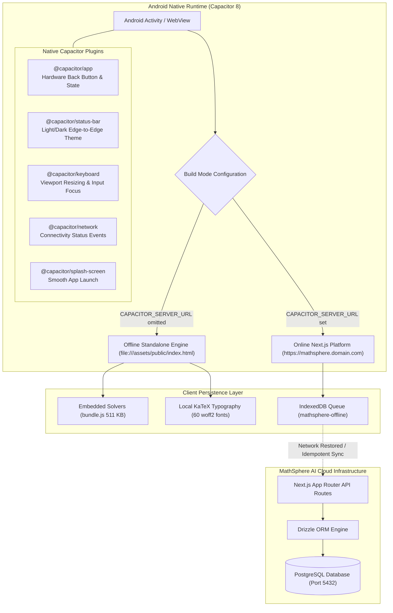

# MathSphere AI — Android Hybrid Architecture

This document provides a comprehensive technical architecture specification for the **MathSphere AI** Android hybrid application (`com.arulagnes.mathsphereai`).

---

## 1. Executive Architecture Overview

MathSphere AI is engineered as an **offline-first, cloud-capable Android hybrid application** powered by **Capacitor 8** and **Next.js 16 (React 19)**.



---

## 2. Dual Operating Modes

The hybrid architecture supports two distinct operational modes:

### Mode 1: Offline Standalone Mode (Default APK)
* **Target Audience:** Students, engineers, and researchers operating without internet access or in airplane mode.
* **Launch Behavior:** Immediately loads the locally bundled Single Page Application from `android/app/src/main/assets/public/index.html` via Capacitor's internal WebView bridge (`https://localhost/`).
* **Mathematical Engines:** Executes the pure TypeScript solvers bundled into `bundle.js` (511 KB) using `esbuild`. All calculations run on-device with zero network latency.
* **Supported Capabilities:**
  - Matrix Arithmetic (addition, subtraction, multiplication, scalar scaling, transpose).
  - Row Operations (Gaussian Elimination, Row Echelon Form `REF`, Reduced Row Echelon Form `RREF`).
  - Matrix Inversion & Determinants (Gauss-Jordan, cofactor expansions).
  - Eigenvalue & Eigenvector Decomposition (characteristic polynomials, Jacobi iterations).
  - Singular Value Decomposition (`SVD`) with full 14-step derivations ($A^T A$, eigenvalues $\lambda_i$, singular values $\sigma_i$, orthonormal vectors $V$, left singular vectors $U$).
  - Moore-Penrose Pseudoinverse ($A^+$).
  - QR Decomposition (Gram-Schmidt orthogonalization).
  - Principal Component Analysis (`PCA`) with data covariance and projection.
  - Number Theory & Cryptography (Euclidean GCD, Extended GCD, modular exponentiation, modular inverse, Chinese Remainder Theorem, Miller-Rabin primality, Pollard's Rho, RSA key generation).
* **Typography:** KaTeX mathematical typesetting using 60 bundled `.woff2` font files. Zero external CDN dependencies.
* **Status Indication:** Clean offline status badge indicating local execution.

### Mode 2: Online-Connected Mode
* **Target Audience:** Users connecting to a deployed MathSphere AI cloud instance.
* **Launch Behavior:** Connects to the public HTTPS backend configured via `CAPACITOR_SERVER_URL` in `capacitor.config.ts`.
* **Extended Capabilities:**
  - Secure user authentication and session management.
  - Interactive "My MathBook" digital notebook with animated two-page book reader.
  - Complete 100+ problem question bank across Foundations, Intermediate, and Advanced levels.
  - Interactive Visualization Laboratory with SVG canvas renderings.
  - Cryptography security laboratory (timing traces, Shannon entropy).
  - Student progress tracking and mastery analytics.
* **Offline Resilience:** If network connectivity is lost while using online mode, user mutations are enqueued in IndexedDB and replayed idempotently upon reconnection.

---

## 3. Native Plugin Integration & Lifecycle

| Plugin | Package ID | Responsibility |
| :--- | :--- | :--- |
| **App** | `@capacitor/app` | Intercepts Android hardware back button. Maintains in-app navigation history stack; prompts confirmation before exiting when at root level. |
| **Status Bar** | `@capacitor/status-bar` | Sets status bar background to match app dark/light theme (`#08090c` / `#ffffff`) with overlay style and safe-area padding. |
| **Keyboard** | `@capacitor/keyboard` | Configures `resizeOnFullScreen` to prevent virtual keyboard from obscuring matrix input cells during editing. |
| **Network** | `@capacitor/network` | Listens for connectivity change events (`networkStatusChange`) and triggers background queue flushing when internet returns. |
| **Splash Screen** | `@capacitor/splash-screen` | Displays branded splash screen on cold start and smoothly animates out once DOM is ready. |

---

## 4. Offline Synchronization & Idempotency Pipeline

```mermaid
sequenceDiagram
    autonumber
    actor User as User / Mobile Client
    participant IDB as IndexedDB (mathsphere-offline)
    participant Sync as Queue Manager (flushQueue)
    participant Net as Network Monitor
    participant API as Backend API (/api/*)
    participant Ledger as Idempotency Ledger (idempotency_keys)
    participant DB as PostgreSQL Database

    User->>IDB: Mutate data (e.g. Save Notebook Note)
    Note over User,IDB: If offline, store pending write with clientRequestId (UUID v4)
    Net->>Sync: Network restored event (online)
    Sync->>IDB: Read all pending writes (status: pending)
    loop For each pending write
        Sync->>API: POST request with X-Client-Request-Id & X-Payload-Hash
        API->>Ledger: Check clientRequestId in database
        alt Request already executed (HTTP 409)
            Ledger-->>API: Return cached response
            API-->>Sync: 409 Conflict (Duplicate Request)
            Sync->>IDB: Remove record (safely reconciled)
        else Request is new
            API->>DB: Execute transaction
            API->>Ledger: Record clientRequestId & response hash
            API-->>Sync: 200 OK (Confirmed)
            Sync->>IDB: Remove record (successful sync)
        else Transient Failure (HTTP 500 / 429 / 408)
            API-->>Sync: Server Error
            Note over Sync,IDB: DO NOT DELETE record; increment retry counter
        else Validation Error (HTTP 400 / 422)
            API-->>Sync: Unprocessable Entity
            Sync->>IDB: Mark status = 'rejected' with error detail (never discard)
        end
    end
```

### Safety Guarantees:
1. **Zero Data Loss:** Queued records are NEVER deleted upon network failures or transient errors.
2. **Double-Write Immunity:** Every queued mutation is tagged with an immutable `clientRequestId` (UUID v4) and cryptographic SHA-256 payload checksum. Replays match existing ledger rows and cannot create duplicate rows.
3. **Rejection Inspection:** Client errors are flagged as `rejected` in IndexedDB so the user can review or revise the input.

---

## 5. Security & Privacy Architecture

* **Zero Embedded Secrets:** The Android APK contains no database credentials, API secret keys, or private signing certificates.
* **HTTPS Enforcement:** Online-connected builds enforce strict HTTPS with network security configuration blocking cleartext HTTP traffic.
* **Cookie Security:** User authentication tokens are stored in `HttpOnly; Secure; SameSite=Lax` cookies, shielding sessions from cross-site scripting (XSS).
* **Scoped Storage:** All local persistence (IndexedDB, localStorage) is scoped strictly to the app sandbox (`com.arulagnes.mathsphereai`).
