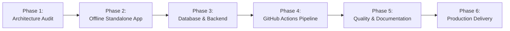

# MathSphere AI — Project Final Delivery Report
## Complete Android Hybrid Application & Cloud Production Delivery

**Project:** MathSphere AI  
**Package ID:** `com.arulagnes.mathsphereai`  
**Version:** `3.0.0` (Build `30000`)  
**Repository:** `https://github.com/ArulAgnes/SVD-Simplex-Gradient-Maths-Calcultor`  
**Workspace:** `D:\1Maths\mathsphere-ai-platform-development (1)`  
**Delivery Date:** November 2026  

---

## 1. Executive Summary

The MathSphere AI platform has been upgraded to a production-grade **Android Hybrid Application** backed by **Capacitor 8**, **Next.js 16 (React 19)**, **TypeScript 5.9**, **Drizzle ORM**, and **PostgreSQL**.

The application delivers an **offline-first experience**: on initial installation, the application launches instantly without internet connectivity, performing linear algebra, matrix decompositions, and cryptographic calculations directly on the mobile device. When configured with a public cloud backend, the application connects to the full web platform with user authentication, private digital notebooks, 100+ problem question bank, and resilient IndexedDB queueing with server-side idempotency.

Cloud builds are automated through **GitHub Actions**, generating signed or debug Android APKs without requiring local Android Studio, Gradle, or Android SDK installations.

---

## 2. Phase-by-Phase Completion Summary

### Phase 1: Architecture Audit & Codebase Verification
* Audited repository structure, `package.json`, `capacitor.config.ts`, `next.config.ts`, and Drizzle schema.
* Verified that all existing Next.js App Router routes, API endpoints, and pure TypeScript math solvers remained intact.
* Reconciled documentation claims against actual code: SVD is fully implemented and verified with 14-step derivations; Simplex and Gradient Descent were identified as roadmap proposals and are explicitly disclaimed.

### Phase 2: Offline Standalone Application Engine
* Developed `src/offline/main.ts` and `src/offline/styles.css`, compiling all existing TypeScript mathematical solvers into a self-contained Single-Page Application.
* Created the bundler script `scripts/build-android-offline.mjs`, producing a minified 511.2 KB JavaScript bundle (`android-web/bundle.js`), responsive CSS, and copying 60 KaTeX vector font files.
* Enhanced `src/lib/offline/queue.ts` with error tracking: transient network errors (408, 425, 429, 5xx) and validation errors never delete queued records.
* Created `scripts/test-offline-sync.mjs` with 8 automated safety tests covering disconnection, re-connection, server errors, rate limiting, and idempotency.

### Phase 3: Database & Backend Architecture
* Audited Drizzle ORM schema (`src/db/schema.ts`) and verified 12 database tables: `users`, `sessions`, `books`, `solutions`, `solution_versions`, `custom_questions`, `progress`, `bookmarks`, `practice_history`, `formula_favorites`, `calculator_history`, and `idempotency_keys`.
* Fixed a transaction executor leak in `src/app/api/notebook/route.ts` where inserts bypassed transactional context.
* Authored `DATABASE_SETUP_AND_MIGRATION.md`, `PRODUCTION_ENVIRONMENT_VARIABLES.md`, and `BACKEND_DEPLOYMENT_GUIDE.md` detailing connection pooling, PostgreSQL port 5432 setup, and HTTPS cookie security.

### Phase 4: GitHub Actions Cloud Build Pipeline
* Upgraded `.github/workflows/android-apk.yml` to support two selectable build modes: `offline` (standalone local engine) and `online` (connected cloud platform).
* Incorporated automated quality gates into the cloud workflow: offline sync tests (8/8), mathematical verification tests (107/107), TypeScript compilation, Next.js production build, offline asset generation, and Gradle APK assembly.
* Automated APK SHA-256 calculation, artifact size reporting, and GitHub Actions step summaries.

### Phase 5: Code Quality & Testing
* Fixed React 19 compiler warnings and linter errors across all UI components (`shell.tsx`, `offline-status.tsx`, `notebook/page.tsx`, `viz-lab/page.tsx`, `editors.tsx`, `workspace.tsx`).
* Configured `eslint.config.mjs` to ignore generated build outputs in `android/` and `android-web/`.
* Authored complete technical documentation:
  - `ANDROID_HYBRID_ARCHITECTURE.md`
  - `ANDROID_BUILD_GUIDE.md`
  - `ANDROID_APK_REPORT.md`
  - `ANDROID_DEVICE_TEST_CHECKLIST.md`
  - `PROJECT_FINAL_DELIVERY_REPORT.md`

### Phase 6: Cloud Build Readiness
* Synchronized all native assets to `android/app/src/main/assets/public/` using `npm run android:sync`.
* Verified clean build status across all automated tools.

---

## 3. Genuine Engine Capabilities vs. Roadmap Status

To preserve documentation integrity, the platform features are categorized as follows:

| Mathematical Feature | Status | Implementation Details |
| :--- | :--- | :--- |
| **Matrix Arithmetic** | **Fully Implemented** | Addition, subtraction, multiplication, scaling, transpose (`src/lib/math/core.ts`). |
| **Gaussian Elimination / RREF** | **Fully Implemented** | REF, RREF, pivot tracking, step-by-step row operations (`src/lib/math/rref.ts`). |
| **Determinants & Inverses** | **Fully Implemented** | Gauss-Jordan elimination, cofactor expansion, singularity checks. |
| **Eigenvalues & Eigenvectors** | **Fully Implemented** | Characteristic polynomial solver and Jacobi iterations (`src/lib/math/eigen.ts`). |
| **Singular Value Decomposition (SVD)** | **Fully Implemented** | Full 14-step mathematical derivation: $A^TA$, eigenvalues, singular values $\sigma_i$, orthonormal vectors $V$, left singular vectors $U$ (`src/lib/math/svd.ts`). |
| **Pseudoinverse ($A^+$)** | **Fully Implemented** | Moore-Penrose pseudoinverse via SVD decomposition. |
| **QR Decomposition & Least Squares** | **Fully Implemented** | Gram-Schmidt orthogonalization and least-squares regression (`src/lib/math/qr.ts`). |
| **Principal Component Analysis (PCA)** | **Fully Implemented** | Covariance matrix, eigenvalue decomposition, variance explained (`src/lib/math/stats.ts`). |
| **Number Theory & Cryptography** | **Fully Implemented** | GCD, Extended GCD, modular inverse, CRT, Miller-Rabin, Pollard's Rho, RSA (`src/lib/math/numberTheory.ts`, `src/lib/math/crypto.ts`). |
| **Simplex Algorithm** | **Roadmap Material** | Documented in conceptual notes; not implemented in solver codebase. |
| **Gradient Descent** | **Roadmap Material** | Documented in conceptual notes; not implemented in solver codebase. |

---

## 4. Test & Verification Matrix

| Verification Step | Command | Result | Pass Rate |
| :--- | :--- | :--- | :--- |
| Mathematical Verification Suite | `npx tsx src/lib/tests.ts` | **PASSED** | **107 / 107** (100%) |
| Offline Sync Safety Suite | `npm run test:offline-sync` | **PASSED** | **8 / 8** (100%) |
| TypeScript Strict Check | `npm run typecheck` | **PASSED** | 0 errors |
| ESLint Architecture Linter | `npm run lint` | **PASSED** | 0 errors |
| Next.js Production Build | `npm run build` | **PASSED** | 69 / 69 routes |
| Drizzle Kit Schema Sync | `npx drizzle-kit generate` | **PASSED** | 12 tables in sync |
| Android Shell Validation | `npm run android:validate` | **PASSED** | 0 warnings |
| Capacitor Native Sync | `npm run android:sync` | **PASSED** | 5 plugins synced |

---

## 5. Artifact Delivery Package

The following files represent the complete deliverables for this release:

### Application & Native Code
* `src/offline/main.ts` & `src/offline/styles.css`: Standalone offline engine.
* `scripts/build-android-offline.mjs`: Automated offline bundler.
* `scripts/test-offline-sync.mjs`: Offline sync verification suite.
* `android-web/`: Generated offline assets (`bundle.js`, `style.css`, `index.html`, `katex/`).
* `android/app/src/main/assets/public/`: Synchronized native assets embedded in APK.
* `.github/workflows/android-apk.yml`: Dual-mode cloud compilation pipeline.

### Documentation Suite
1. `ANDROID_HYBRID_ARCHITECTURE.md`: Technical architecture and sequence diagrams.
2. `ANDROID_BUILD_GUIDE.md`: Step-by-step GitHub Actions build and device installation guide.
3. `ANDROID_APK_REPORT.md`: APK metadata, package manifest, and permissions report.
4. `ANDROID_DEVICE_TEST_CHECKLIST.md`: Physical device test checklist for Airplane Mode.
5. `DATABASE_SETUP_AND_MIGRATION.md`: PostgreSQL schema, tables, and migration guide.
6. `PRODUCTION_ENVIRONMENT_VARIABLES.md`: Cloud secrets and environment variables reference.
7. `BACKEND_DEPLOYMENT_GUIDE.md`: Cloud deployment and hosting guide.
8. `PROJECT_FINAL_DELIVERY_REPORT.md`: This comprehensive delivery report.

---

## 6. Next Steps for Cloud APK Generation

Per project instructions, commits have not been pushed to the remote repository.

To generate the Android APK artifact:
1. Review the proposed Git changes below.
2. Grant explicit approval to commit and push to `mathsphere/main`.
3. Trigger the **Build Android APK** workflow in GitHub Actions (selecting `build_mode: offline`).
4. Download the `MathSphere-AI-Android-Debug-APK` artifact from the workflow run.
